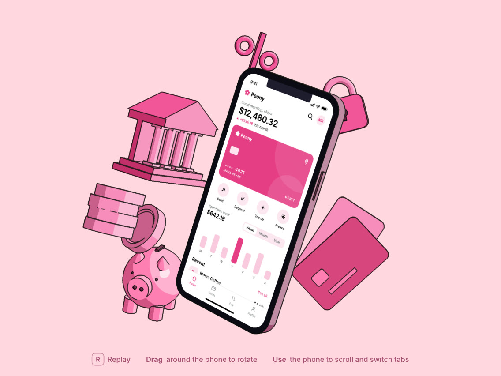

# Peony



A banking app home screen on a 3D phone, built entirely with the [Rive CLI](https://rive.app/docs/cli/overview).
The phone and props are real 3D (a glTF file) rendered on Rive's GPU canvas with WGSL shaders and styled to look
like flat vector art. The phone's screen is a live Rive artboard with layouts, text, a state machine and data
binding: balance, card, quick actions, a Week, Month and Year spending chart, and recent transactions. You can tap
and scroll it on the 3D phone.

Peony is a fictitious bank, and every name and number in the UI is made up.

The whole project is plain source files: RML markup for the artboards (`scene.rml`, generated by `tools/gen.py`),
AnimaScript for the loader, renderer and input, and WGSL for the shaders.

## Run it

1. Install the Rive CLI:

   ```bash
   curl -fsSL https://releases.rive.app/cli/install.sh | sh
   ```

2. From this folder:

   ```bash
   rive .
   ```

   This builds `build/peony-bank.riv` and opens the preview window.

## Controls

| Input | Action |
|---|---|
| drag | rotate the phone |
| tap or scroll on the phone | use the app: switch Week, Month and Year, scroll the screen |
| R, or the Replay button | replay the entrance |

The scene opens with the animated Rive wordmark. Set the `splash` view model property to `0` to skip it.

## How it's built

| Piece | Where |
|---|---|
| Hero artboard, Phone Screen artboard, view model, state machines | `scene.rml`, generated by `tools/gen.py` (edit the generator, not the RML) |
| Animated Rive wordmark | `logo.rml` |
| GLB loader: parses the file and uploads every mesh to the GPU | `glb.as` |
| Renderer, camera, entrance and idle motion, splash, input | `world.as` |
| Shaders: cel shading, ink lines, downscale | `toon.wgsl`, `ink.wgsl`, `resolve.wgsl` |
| 3D scene | `assets/scene.glb`, generated by `tools/make_scene_glb.py` |
| Font | `Inter.ttf`, plus `fonts/Inter-used.ttf` (only the glyphs the file uses, made by `tools/subset_font.py`) |

The renderer draws a supersampled G-buffer, shades each material with a 3-tone ramp built from its base colour,
draws ink lines at object and material edges, creases and depth steps, then box-filters the result down to the
canvas. Any material named `Screen` is textured with the live Phone Screen artboard, and the pointer is ray-cast
into it, so the app on the phone works like the real thing.

## Use your own 3D scene

Export your scene as glTF binary to `assets/scene.glb` and name the phone's display material `Screen`. Every other
material is restyled from its base colour, and top-level nodes get the idle float. If the file has a camera, it
frames the shot. Textures, skins and glTF animations are ignored.

## Edit it

- Text and numbers live in the **Peony** view model: `greeting`, `balance`, `change`, `period`, `cardNumber`,
  `cardName`, `spendPeriod`, `spendAmount` and `range`, plus `lineWidth` and `motion` for the 3D look.
- To change the generator or the scene, rebuild with:

  ```bash
  python3 -m venv .venv && .venv/bin/pip install numpy fonttools
  .venv/bin/python tools/make_scene_glb.py
  .venv/bin/python tools/gen.py
  rive .
  ```

- To work on it in the Rive Editor, run `rive login`, then `rive push`. The first push creates a file in your Rive
  account and records the link in `rive.yaml`. Bring changes back with `rive pull`.

For the web, build with `EMBED_FONT=1 python3 tools/gen.py` first so the font is inside the file, then
`rive . --publish`.

## Credits

- **Font:** [Inter](https://github.com/rsms/inter) by The Inter Project Authors, under the
  [SIL Open Font License 1.1](https://openfontlicense.org) (license text in `licenses/`).
- The 3D scene is generated by `tools/make_scene_glb.py` for this project.

## License

The code and generators are released under the [MIT License](LICENSE). The font keeps its own license (SIL OFL
1.1). The Rive name and logo are trademarks of Rive Inc.
